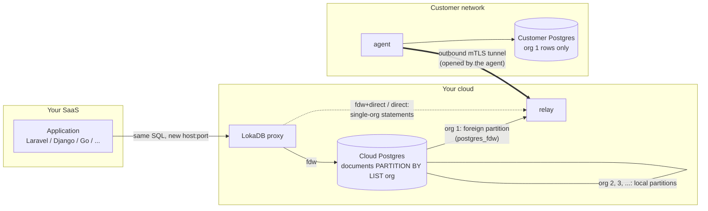
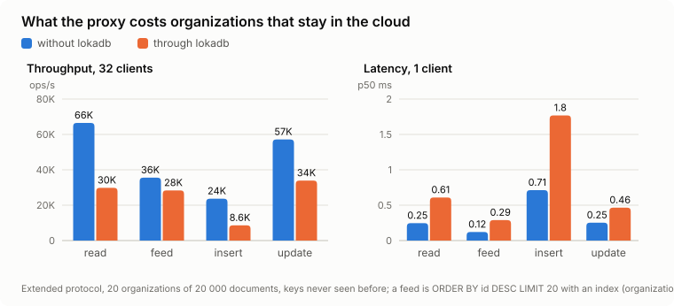
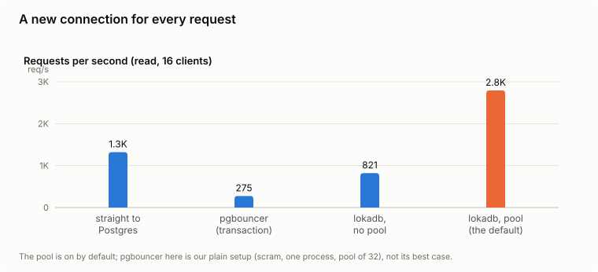

# LokaDB

**Let your SaaS customers keep their data in their own Postgres — without rewriting your app.**

[](https://github.com/lokadb/lokadb/actions/workflows/ci.yml)
[](LICENSE)
[](https://github.com/lokadb/lokadb/releases)

Enterprise customers increasingly ask a multi-tenant SaaS for the same thing: *"our data stays in our database."* The usual answers are expensive — a single-tenant deployment per customer, or a rewrite of the data layer so every query knows which database to talk to.

LokaDB is a Postgres wire-protocol proxy that takes a third way. Your application keeps one database connection string and keeps sending the SQL it sends today. LokaDB stores the rows of the tables you choose, for the organizations you choose, in **each organization's own Postgres**, and leaves everything else in your cloud database. Moving an organization out, and back, happens online while the application writes.


> **Status:** early. LokaDB runs three unmodified demo applications (Laravel, Django, Go) end to end and is suitable for **a limited pilot on a compatible application**. It is not a drop-in for every schema or every workload: see [What's supported](#whats-supported) and [the roadmap](ROADMAP.md).

---

## How it works

LokaDB converts the chosen tables of your cloud database into tables partitioned by organization, without copying rows. An organization that stays in the cloud lives in a local partition. An organization that moves gets a partition that is a `postgres_fdw` foreign table pointing at its own database. The proxy parses every statement with the real Postgres parser, finds the organization in it (the tenant column, a row id, a foreign key, a declared relation), and tells Postgres which partition to use; a statement that names no organization is refused by default rather than sent to every customer database. The cloud never connects into the customer's network: an **agent** inside that network opens an outbound mutual-TLS tunnel to a **relay** in your cloud, and all traffic to the customer database goes through it. For organizations far from the cloud, the proxy can send statements that touch only that organization's tables straight to its database through the same tunnel, skipping the extra round trips of `postgres_fdw`.



Each moved organization has a **routing profile**:

| Profile | Path | Use when |
|---|---|---|
| `fdw` | every statement goes to the cloud Postgres, which reads the organization through `postgres_fdw` | the organization is close to the cloud, or the workload joins its tables with cloud tables a lot |
| `fdw+direct` (default when direct credentials are configured) | statements that touch only this organization's tables go straight to its database; the rest go through `postgres_fdw` | the usual choice for a remote organization |
| `direct` | no `postgres_fdw` path at all; the cloud database holds no credentials for the organization | the application names the organization itself ([cooperative mode](docs/profiles-and-cooperative-mode.md)) |

## Try it

**In the browser.** [the online demo](https://play.lokadb.com) runs a demo stand: a cloud database, organizations in their own databases, a demo application, and the compatibility report — nothing to install.

**Locally, with Docker.** One command starts a cloud Postgres, one organization's Postgres behind the relay and the agent, the proxy, and a small application that keeps writing for two organizations; it then runs `check`, `enable` and `move-org` and shows where each organization's rows ended up ([docs/quickstart.md](docs/quickstart.md)). Run it from the root of this repository:

```bash
docker compose -f quickstart/compose.yml up --build
```

The full test stand — three applications and several hundred end-to-end and defect checks — is `bash e2e/run.sh` (see [docs/testing.md](docs/testing.md)).

## Adoption path

Each step is one command; every step can be stopped and undone.

| Step | Command | What it does |
|---|---|---|
| 1. Check | `lokadb check -db … -spec spec.json -workload workload.json` | Reads the schema, the recorded workload and both databases, and reports what blocks the move, what LokaDB does not support yet, and what will behave differently. Changes nothing. |
| 2. Enable | `lokadb enable -db … -spec spec.json` | Converts the chosen tables to partitioned tables in place (online preparation with `enable -prepare` for large tables). All organizations stay in the cloud. |
| 3. Move | `lokadb move-org -db … -org 1 -customer … -customer-app …` | Moves one organization to its own database while the application keeps writing; writes of the organization pause for the switch-over — seconds for an organization tens of milliseconds away (see [Performance](docs/performance.md#moving-an-organization-under-writes)). |
| 4. Profile | `lokadb org-profile -db … -org 1 fdw+direct` | Chooses how the proxy reaches that organization. |
| 5. Back | `lokadb move-back -db … -org 1 -customer …` | Returns the organization to the cloud; `lokadb disable` then undoes `enable`. |

The application only changes its connection string to point at the proxy (`host`, `port`). Relations your schema does not declare as foreign keys (common in Rails and Laravel), cross-organization reports and background jobs need a decision from you: `lokadb check` lists every such query with the reason no organization was found, and you declare the missing relations in the spec (`routing.relations`) or allow the reviewed reports. See [docs/check.md](docs/check.md) and [docs/routing.md](docs/routing.md).

## What's supported

- **Applications:** tested end to end with unmodified **Laravel** (Eloquent, artisan migrate), **Django** (ORM, migrate) and **Go** (GORM over pgx), plus extended-protocol clients (pgx, psycopg, JDBC, PDO).
- **Finding the organization:** equality, `IN` and `= ANY(array)` on the tenant column, the row key or a foreign key, in literals and in bound parameters (text and binary); `INSERT … VALUES` and `UNNEST` (Django `bulk_create`); joins through equal columns; subqueries that name the organization. Relations without a foreign key, cloud tables that know the organization, and unique keys can be declared.
- **Statement forms:** upsert (`ON CONFLICT`), `MERGE` (one matched and one not-matched branch), `COPY FROM STDIN` and `COPY TO`, cursors including `WITH HOLD`, `LISTEN`/`NOTIFY`, prepared statements surviving `enable` and migrations.
- **Schemas:** keys of type `smallint`, `integer`, `bigint`, `uuid`, `text`/`varchar` (deterministic collation) and composite keys; tenant column of integer or `uuid` type; tables in any schema; materialized views, views, rules, functions over the row type, row-level security of the application, identity columns, publications; extensions, enums, domains, collations and functions are created in the customer database when needed.
- **Migrations:** column changes, `RENAME COLUMN`, `CREATE INDEX` (including `CONCURRENTLY`) are replayed in every customer database before the cloud commits; `lokadb schema-diff` / `schema-sync` reconcile a schema that drifted.
- **Moving:** online move without logical replication (trigger-based capture, works on managed Postgres) or with it; move back; change of the customer database (`repoint`); `disable`.
- **Tunnel:** one-time enrolment tokens, automatic certificate renewal, revocation in two seconds, several relays and several agents per organization, CA key in a separate issuing service, end-to-end TLS to the customer database.

**Scale:** one partition per organization. Up to about 100 organizations there is no noticeable price; at 1000 throughput is lower (reads and updates by a third to a half, inserts by about a third) and at 3000 inserts fall to about 1,400 ops/s, so we do not recommend mixed writes at that scale yet. Details and the mechanism in [docs/limits.md](docs/limits.md#how-many-organizations-one-cloud-database-can-hold).

### Not yet

- Child tables that get the organization through a **composite** foreign key, and polymorphic references (`<x>_type` + `<x>_id`); declared relations with a condition on the type.
- Tenant columns of `text` type; row keys of other types (`numeric`, `char(n)`, `citext`, dates, enums, non-deterministic collations).
- Constraint triggers and triggers with transition tables on the moved tables.
- Atomic commit across the cloud and a customer database: they are two commits, as with any `postgres_fdw` write.
- `TRUNCATE`, `DROP TABLE`, table renames and new constraints on the moved tables through the proxy (refused with an explanation).
- Moving several organizations of one cloud database at the same time (they move one after another).
- Automatic provisioning of the customer database: the customer provides it.
- A connection pooler in `transaction` mode **between** the proxy and Postgres (a pooler in front of the proxy is fine).

The full list, and what is planned, is in [ROADMAP.md](ROADMAP.md) and [docs/limits.md](docs/limits.md).

## Performance

Measured on eight separate servers, not in Docker on one machine: a cloud database (8 cores, 32 GB), the proxy together with the relay (4 cores, 16 GB), a load generator (4 cores, 16 GB), and the databases of four organizations (2 cores, 4–8 GB each) at 0.19, 9.4, 38.7 and 43.3 ms round-trip time from the cloud. Postgres 18, `fsync` on, one scenario at a time; every point is 60 s after 15 s of warm-up, two repeats, the median. All figures are **for this workload** — access by primary key and by an `(organization_id, id)` index; another workload gives other numbers. Method, scenarios and raw results are in `research/bench/`; the numbers behind every chart are in [charts-data.md](research/bench/charts-data.md).

**Organizations that stay in the cloud.** A statement costs 0.2–1 ms more through the proxy; with 32 clients the throughput is 36–80 % of a direct connection (read 66,500 → 29,800 ops/s, update 57,200 → 33,900, feed 35,500 → 28,400, insert 23,700 → 8,600). A whole Django application with 16 clients was 5–10 % slower through LokaDB than without it. That makes the cloud path suitable for a limited pilot on a compatible application — a conclusion about this workload, not a guarantee.

<p align="center"><picture>
  <source media="(prefers-color-scheme: dark)" srcset="docs/img/bench/proxy-cost-dark.svg">
  
</picture></p>

**A new connection for every request** (PHP-FPM without persistent connections, serverless; 16 clients, one read). LokaDB's built-in connection pool, on by default for all databases, gave 2,795 requests/s — about twice a direct connection to Postgres (1,321). pgbouncer in our simple setup (scram, one process, a pool of 32) gave 275 — a measurement of our setup, not a limit of pgbouncer. An application that already has its own pool sees no gain.

<p align="center"><picture>
  <source media="(prefers-color-scheme: dark)" srcset="docs/img/bench/new-connection-dark.svg">
  
</picture></p>

**A moved organization** pays for distance: its latency is almost linear in the round-trip time. At 43 ms a read through `fdw` takes 352 ms and through `fdw+direct` 133 ms; an update 351 and 89 ms. The same page has the ceilings by number of clients and of organizations, the pause of a move and the load limit: [docs/performance.md](docs/performance.md). Where the round trips come from and what to tune is explained there too.

**Improved by changes made after these measurements, not re-measured:**

- **the pause of an organization's writes at its first move** (the split out of the DEFAULT partition): measured 6 s at 60 MB and 66 s at 600 MB; the split now runs online in batches, estimated at about 1 s and 13 s;
- **a trigger-mode move under heavy writes** (8 writers) did not converge; the catch-up now applies changes in rounds of up to 5,000 records or 8 MB in one pipeline;
- **a relay restart** took about 60–77 s before the agents were back; the drain is now 0–5 s and the agents are signalled to reconnect;
- **thousands of organizations:** prepared statements are no longer evicted from the connection's cache (re-planning at 1000 organizations fell from 81 % to 22 % of statements), and the connection pool is on by default.

## Security model

LokaDB promises one thing: **the rows of the chosen tables of a moved organization are stored only in that organization's database.**

- **The proxy is the boundary.** Routing is done by the proxy; the row-level security policies LokaDB installs are routing, not a security barrier. A connection to the cloud database that bypasses the proxy sees every organization's rows, as without LokaDB. Close direct access to the cloud database: only the proxy, the relay and administrators may connect (`lokadb check -proxy-hosts` verifies `pg_hba`). Roles that bypass RLS are refused by the proxy.
- **Narrow, never widen.** The proxy only takes the organization from the statement itself. A wrong guess yields an empty or partial answer, never another organization's rows; a statement with no organization is refused by default; a statement in which the proxy sees no LokaDB table runs under "no organization" rather than "all organizations".
- **Not an authorization layer.** If the application asks for another organization's document by id, the proxy routes the query to where that document lives. Who may read what is still the application's job.
- **The cloud never reaches into the customer network.** The agent opens the only connection, outbound, with mutual TLS; tokens are single-use; the agent's private key never leaves its machine; certificates renew themselves and can be revoked. TLS can run end to end from the cloud to the customer database so that the relay sees only ciphertext.
- **What LokaDB does not isolate:** your application's caches, queues, search indexes, files, logs and error reports; backups and replicas made before the move; and, on the `fdw` profile, the moved rows in transit through the cloud Postgres (memory, temporary files, logs if `log_statement` is on). The full list is in [docs/limits.md](docs/limits.md#what-lokadb-does-not-isolate); promise customers isolation only together with that list.

Report vulnerabilities as described in [SECURITY.md](SECURITY.md).

## Status

LokaDB is under active development by a small team. The core — `check`, `enable`, the proxy, `move-org`, the way back, migrations, the tunnel — is complete for the supported scope and is covered by an end-to-end stand and a suite of regression checks for every defect found so far. It has not yet run a production customer. What is next is in [ROADMAP.md](ROADMAP.md).

## Documentation

| | |
|---|---|
| [Install on your database](docs/install.md) | from nothing to a proxy in front of your own Postgres, then the first organization moved |
| [Quickstart](docs/quickstart.md) | run the demo locally |
| [Configuration](docs/configuration.md) | `lokadb.json` (proxy), `relay.json`, `issuer.json`, the spec file, passwords |
| [Compatibility check](docs/check.md) | `lokadb check`: findings, verdicts, suggestions, latency forecast, JSON, CI baseline |
| [Routing](docs/routing.md) | how the organization is found, the policy for statements without one, declarations |
| [Profiles and cooperative mode](docs/profiles-and-cooperative-mode.md) | `fdw`, `fdw+direct`, `direct`; the application naming the organization |
| [Tunnel](docs/tunnel.md) | relay, agent, enrolment, renewal, revocation, high availability, TLS |
| [Moving organizations](docs/moving.md) | `enable`, `move-org`, large organizations, where the customer database comes from |
| [The way back](docs/rollback.md) | `move-back`, `repoint`, `disable` |
| [Migrations](docs/migrations.md) | DDL replay, `schema-diff`/`schema-sync`, `refs-diff`/`refs-sync` |
| [Schemas and keys](docs/schemas.md) | non-`public` schemas, UUID and text keys, composite keys, UUID organizations |
| [Limits and isolation](docs/limits.md) | what LokaDB does not isolate, known limitations, deployment checklist |
| [Performance](docs/performance.md) | round trips, profiles, pools and caches, tuning |
| [Testing](docs/testing.md) | the e2e stand and the regression checks |

## Check in CI, and the hosted service

`lokadb check` is open and complete in every `lokadb` binary and image: the schema and catalog, permission probes, blockers and limitations, the workload, suggested routing declarations with a ready patch (`-suggest`, `-patch`), the latency forecast with N+1 detection (`-rtt`), feed index advice and JSON for CI.

**[lokadb/check](https://github.com/lokadb/check)** has the GitHub Action that runs it on every pull request of your application, the report format (JSON Schema, finding codes, sample reports) and the check documentation.

**[lokadb.com](https://lokadb.com)** adds, as a service: the report as an interface with fixes and ready-to-apply patches, an AI advisor over the findings, and comparison of reports over time.

## Contributing

Issues and pull requests are welcome; see [CONTRIBUTING.md](CONTRIBUTING.md). Go code is built and tested in Docker (`golang:1.25`); a change that touches routing, moving or the tunnel should come with a check in `e2e/defects` that fails before it and passes after.

## License

[Apache-2.0](LICENSE).
