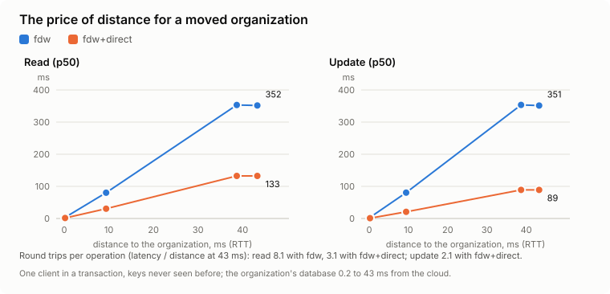
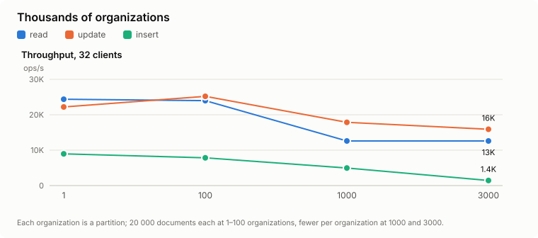
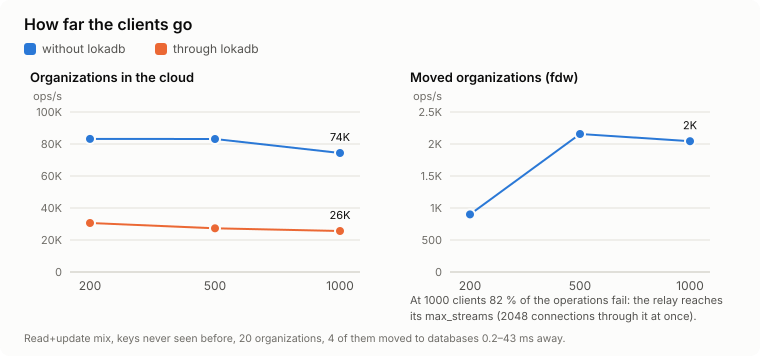
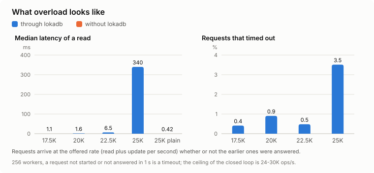
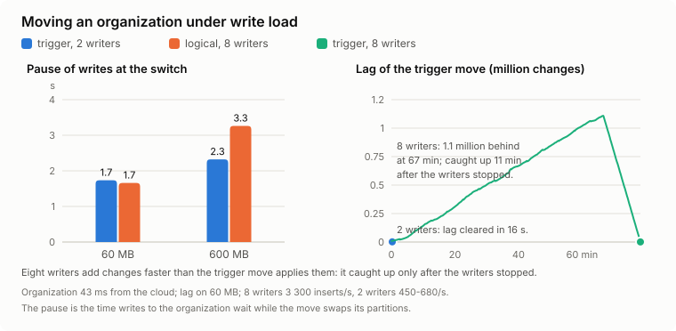

# Performance reference

Measured on eight separate servers, not in Docker on one machine: a cloud database (8 cores, 32 GB), the proxy together with the relay (4 cores, 16 GB), a load generator (4 cores, 16 GB), and the databases of four organizations (2 cores, 4–8 GB each) at 0.19, 9.4, 38.7 and 43.3 ms round-trip time from the cloud. Postgres 18, `fsync` on, one scenario at a time; every point is 60 s after 15 s of warm-up, two repeats, the median. All figures are **for this workload** — access by primary key and by an `(organization_id, id)` index; another workload gives other numbers. Method, scenarios and raw results are in `research/bench/`; the numbers behind every chart are in [charts-data.md](../research/bench/charts-data.md).

The structure of the cost — which round trips an operation makes — and what to tune come first; the measured results follow.

## Where the round trips go on `fdw`

Every statement on a moved organization through the `fdw` profile is executed by `postgres_fdw` in the cloud, which talks to the organization's database. Counted on the organization's statement log:

| Operation | What reaches the organization's database | Round trips |
|---|---|---|
| a single read | `START TRANSACTION`, `DECLARE` cursor, `FETCH`, `CLOSE`, `COMMIT` | ≈5 |
| an ORM-style read: a document, then the count of its versions | twice 5 | 10 |
| insert | `PREPARE`, `EXECUTE`, `DEALLOCATE` per `INSERT`, plus begin and commit | 3 per insert + 2 |
| `UPDATE` or `DELETE` | cursor `FOR UPDATE`, `UPDATE … WHERE ctid = $1` (prepared), `CLOSE`, begin, commit | 8 |
| transaction | one `START` and one `COMMIT` for all its statements | +2 |
| first statement of a new client connection | login (SCRAM), a tunnel stream, five `SET`s of `postgres_fdw` | +9 |

The time of an operation is these round trips multiplied by the round-trip time to the organization.

- `UPDATE` and `DELETE` cost 8 because LokaDB keeps row triggers on the foreign partition (`__refs`, the parent check, foreign keys to cloud tables, key maps); with a row trigger `postgres_fdw` cannot push the whole statement down. Without them it would be 3.
- The `+9` per connection is why the **cache of cloud connections (`upstream_pool`) is on by default for all databases** (`"upstream_pool": false` turns it off): a cloud backend and its `postgres_fdw` connection stay warm between clients. An application that connects per request (PHP, serverless) would otherwise pay these round trips on every request.
- LokaDB itself sends nothing extra to the organization's database: `lokadb.org`, the pause and `__refs` lookups go to the cloud.

## `fdw+direct`

A statement that touches only one organization's LokaDB tables goes straight to its database through the tunnel: about one round trip per statement, about one and a half including the cloud-side checks, instead of five to eight (measured inside a transaction, begin and commit included: a read about 3 round trips and an update about 2, against about 8 on `fdw`). This is why `move-org` sets `fdw+direct` whenever the direct-path credentials are configured. Keep `fdw` for organizations close to the cloud, or for workloads that mostly join an organization's tables with cloud tables (those go through the cloud on any profile).

## An ORM feed with a join

A feed with a cloud join (Django `select_related("project")…order_by("-id")[:20]`) is addressed by the proxy to the organization's partition with the organization condition added, so `ORDER BY` runs in the organization's database and the cursor stops after the first rows, instead of the cloud pulling all of the organization's rows and sorting them. `LIMIT` under a join is not pushed down by `postgres_fdw`; `ORDER BY` is.

## Tuning

- **Indexes.** A feed (`WHERE organization_id = $1 ORDER BY id DESC LIMIT 20`) needs `(organization_id, id)`, as without LokaDB.
- **Statistics of foreign partitions.** Autovacuum does not analyze foreign tables; run `ANALYZE <parent table>` while organizations grow, otherwise aggregates and `LIMIT` are not pushed to the organization.
- **Connections.** Leave `upstream_pool` on. Turn on `direct_pool` for `fdw+direct` when clients connect per request. For applications that connect per request, `"meta_cache": {"verify": "1s"}` lets new connections skip the metadata freshness check (changes reach new connections up to a second later; live sessions learn at once).
- **When measuring:** keep `route_log` off (one log line per statement costs throughput), do not record (`-record`), keep the metadata cache on.
- **Tunnel window.** The multiplexer window is 4 MiB per stream by default (`LOKADB_MUX_WINDOW_KB`): a stream is limited to window ÷ round-trip time, so a small window throttles reading a large organization over a long link. Larger windows add little and raise worst-case relay memory.
- **`fetch_size`.** LokaDB sets 1000 on organization servers (100 is the `postgres_fdw` default): fewer round trips when reading many rows.

## The cost of the proxy itself

The proxy adds a network hop, a `set_config` before statements on LokaDB tables, and parsing. A point read of one organization grows slowly with the number of organizations (see [limits](limits.md#how-many-organizations-one-cloud-database-can-hold)). A new client connection pays a metadata freshness check unless the shared metadata cache or the cloud connection cache absorbs it.

Proxy limits: `max_connections` (1000), `max_message_bytes` (256 MB), 30 s to connect and authenticate.

## Measured results

### Organizations that stay in the cloud

A statement costs 0.2–1 ms more through the proxy (p50, one client: read 0.25 → 0.61 ms, feed 0.12 → 0.29, insert 0.71 → 1.77, update 0.25 → 0.46). With 32 clients the throughput is 36–80 % of a direct connection: read 66,496 → 29,799 ops/s, update 57,166 → 33,880, feed 35,526 → 28,375, insert 23,673 → 8,612. A whole Django application with 16 clients was 5–10 % slower through LokaDB (read 2,008–2,127 against 2,239 ops/s, feed 2,830 against 3,030).

<picture>
  <source media="(prefers-color-scheme: dark)" srcset="img/bench/proxy-cost-dark.svg">
  
</picture>

### A new connection for every request

16 clients, one read per connection: straight to Postgres 1,321 requests/s; pgbouncer in transaction mode (our simple setup) 275; LokaDB with its built-in pool, on by default, 2,795 — about twice a direct connection. An application that already has its own pool sees no gain.

<picture>
  <source media="(prefers-color-scheme: dark)" srcset="img/bench/new-connection-dark.svg">
  
</picture>

### The price of distance

Latency of one operation of a moved organization in a transaction, one client, p50, by round-trip time from the cloud:

| RTT | read, `fdw` | read, `fdw+direct` | update, `fdw` | update, `fdw+direct` |
|---|---|---|---|---|
| 0.19 ms | 3.5 ms | 1.4 ms | 3.4 ms | 1.1 ms |
| 9.4 ms | 80.3 ms | 30.5 ms | 80.5 ms | 20.8 ms |
| 38.7 ms | 353 ms | 133 ms | 353 ms | 89.1 ms |
| 43.3 ms | 352 ms | 133 ms | 351 ms | 89 ms |

Latency is almost linear in the round-trip time: about 8 round trips to the organization's database for a read through `fdw` (begin and commit included), about 3 through `fdw+direct`, and about 2 for an update on `fdw+direct`.

<picture>
  <source media="(prefers-color-scheme: dark)" srcset="img/bench/fdw-vs-direct-dark.svg">
  
</picture>

### Thousands of organizations

Throughput through the proxy, 32 clients, by the number of organizations (ops/s):

| organizations | read | update | insert |
|---|---|---|---|
| 1 | 24,371 | 22,209 | 8,952 |
| 100 | 23,984 | 25,194 | 7,846 |
| 1000 | 12,596 | 17,853 | 4,961 |
| 3000 | 12,606 | 15,908 | 1,432 |

Up to 100 organizations the cost does not grow. At 1000, compared with 100, reads lose about 47 %, updates about 30 % and inserts about 37 %; at 3000 inserts fall another 3.5 times (1,432 ops/s, p99 116 ms). A point read of one organization takes 0.55 ms with one organization and 1.1 ms with 3000 (one client); the first statement after connecting takes 1.6 ms with one organization and 14.8 ms with 3000. The mechanism is in [limits](limits.md#how-many-organizations-one-cloud-database-can-hold).

<picture>
  <source media="(prefers-color-scheme: dark)" srcset="img/bench/scale-orgs-dark.svg">
  
</picture>

### Ceilings by the number of clients

Read and update, ops/s:

| clients | cloud, without LokaDB | cloud, through LokaDB | moved, `fdw` | moved, `fdw`: operations that failed |
|---|---|---|---|---|
| 200 | 83,162 | 30,655 | 900 | 0 % |
| 500 | 83,095 | 27,286 | 2,156 | 0 % |
| 1000 | 74,397 | 25,608 | 2,044 | 82 % |

Moved organizations on `fdw` are limited by the network to the organization, not by the processor. With 1000 clients 82 % of the operations on moved organizations were refused a connection: in this scenario the relay's `max_streams` is the ceiling (2048 connections through the relay to all organizations together; every `fdw` client keeps its own connection to the database of every organization it touches). As an **approximation for this scenario**: clients through `fdw` ≤ `max_streams` ÷ the number of moved organizations a client touches, and not more than the organization database's `max_connections` and the agent's `-max-conns`. What helps: raising `max_streams` (relay memory up to 4 MiB per connection in the worst case), `fdw+direct` with `direct_pool`, a pooler in front of the proxy, fewer clients per organization.

<picture>
  <source media="(prefers-color-scheme: dark)" srcset="img/bench/client-ceiling-dark.svg">
  
</picture>

### Overload

Open model: requests arrive at a set rate (256 workers, read and update, timeout 1 s), organizations in the cloud, through the proxy:

| offered ops/s | read p50 | read p99 | timeouts |
|---|---|---|---|
| 17,500 | 1.1 ms | 517 ms | 0.4 % |
| 20,000 | 1.6 ms | 536 ms | 0.9 % |
| 22,500 | 6.5 ms | 718 ms | 0.5 % |
| 25,000 | 340 ms | 1,019 ms | 3.5 % |
| 25,000 without LokaDB | 0.42 ms | — | 0.0 % |

Up to 22,500 ops/s the latency grows smoothly; at 25,000 the limit is reached, while the same rate is accepted in full without LokaDB.

<picture>
  <source media="(prefers-color-scheme: dark)" srcset="img/bench/overload-dark.svg">
  
</picture>

### Moving an organization under writes

An organization 43 ms from the cloud, 60 and 600 MB, writers running all the time; the *pause* is the window in which the organization's writes wait.

| size | pause at the switch, trigger mode (2 writers) | pause at the switch, logical mode (8 writers) |
|---|---|---|
| 60 MB | 1.74 s | 1.66 s |
| 600 MB | 2.32 s | 3.26 s |

A 600 MB move takes about 8 minutes in both modes (trigger with 2 writers 464 s, logical with 8 writers 457 s); 60 MB takes 78 and 61 s. The first move of an organization out of the DEFAULT partition adds a pause of that organization's own writes (about 6 s at 60 MB, about a minute at 600 MB in this run). Trigger mode with 8 writers (3,300 inserts/s) does not keep up: changes arrive at about 1,845/s and are applied at about 1,570/s, so the lag grows by 275/s and converges only 12 minutes after the writers stop; with 2 writers (450–680/s) it converges at once. The drop in the writers' throughput in logical mode (760–1,160 inserts/s against 3,300) is the load of the initial copy by the subscription, not a lock. After every move the rows were verified: by organization in the right place, none of another organization's, growth equal to the number of successful inserts.

<picture>
  <source media="(prefers-color-scheme: dark)" srcset="img/bench/pause-by-size-dark.svg">
  
</picture>

### Other paths through the proxy

p50 for an organization in the cloud / a moved one through `fdw`: `COPY` out of a query (300,000 rows) 413 / 929 ms; `COPY` in of 10,000 rows 429 ms / 3.8 s (42 ms directly into Postgres); a cursor with a batch of 1,000 rows 2.7 / 5.0 ms; `LISTEN` / `NOTIFY` 0.57 / 0.39 ms. `COPY <table> TO STDOUT` without choosing an organization is refused by the proxy.

### Failures

Stopping the database of one organization for 30 s gave errors to that organization only (1,191 of 2,633 operations); the other organizations got 0–1 errors in 2,700 and the cloud ones 0 in 42,000. Stopping an agent behaves the same (631 of 2,611). Connected agents cost almost nothing: a hundred extra add about 10 ms (2 %) to another organization's latency, and the relay holds 100 agents in 34 MB.

### Serialization errors (`40001`)

Through `fdw`, a concurrent change of one row gives `could not serialize access due to concurrent update`: `postgres_fdw` opens a `REPEATABLE READ` transaction in the organization's database. This is an error the application must be able to retry: on hot keys up to a few percent of updates (6 % with 50 clients), on uniform keys about 0.03–0.1 %. It is safe to retry whole transactions made of reads and updates by primary key with no side effects; inserts without a unique key must not be retried (a retry can create a duplicate).

### Improved after these measurements, not re-measured

- **the pause of an organization's writes at its first move** (the split out of the DEFAULT partition): measured 6 s at 60 MB and 66 s at 600 MB, of which about 53 s was the copy; the copy now runs while the organization works (a test with 300,000 rows under writes: 0.7 s instead of 12.5 s), and what remains under the pause is the `DELETE` from DEFAULT, about 2 s per million rows;
- **a trigger-mode move under heavy writes** (8 writers) did not converge; the catch-up now applies changes in rounds of up to 5,000 records or 8 MB in one pipeline;
- **a relay restart** took about 60–77 s before the agents were back; the drain is now 0–5 s and the agents are signalled to reconnect;
- **thousands of organizations:** prepared statements are no longer evicted from the connection's cache (re-planning at 1000 organizations fell from 81 % to 22 % of statements), and the connection pool is on by default.

### Not measured yet

`enable` of a large table under writes and tables of 1–100 million rows; Laravel through LokaDB (Laravel without LokaDB was measured); a point at 48 ms; 200 agents (10, 50 and 100 were measured); loss of packets; moving 10 GB; managed Postgres and a real WAN beyond the four distances above.
