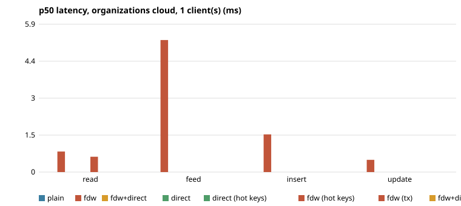
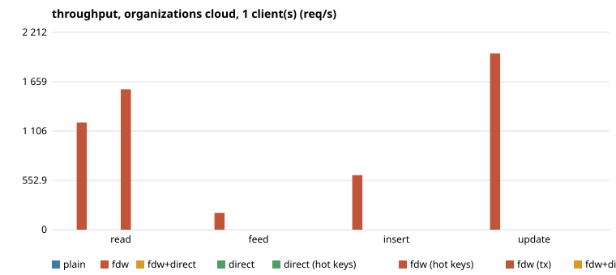
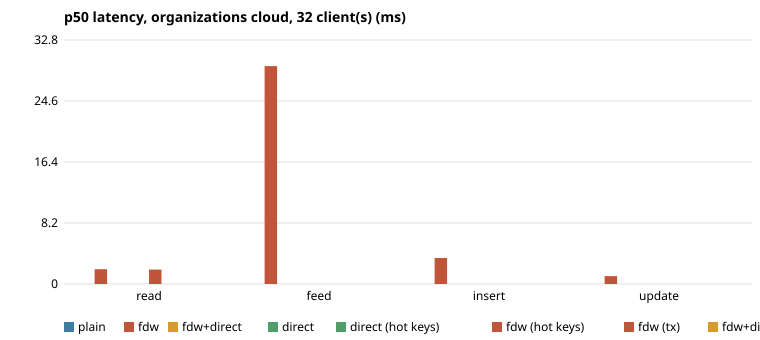
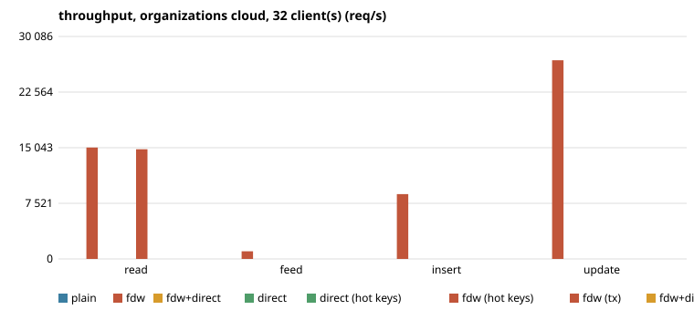
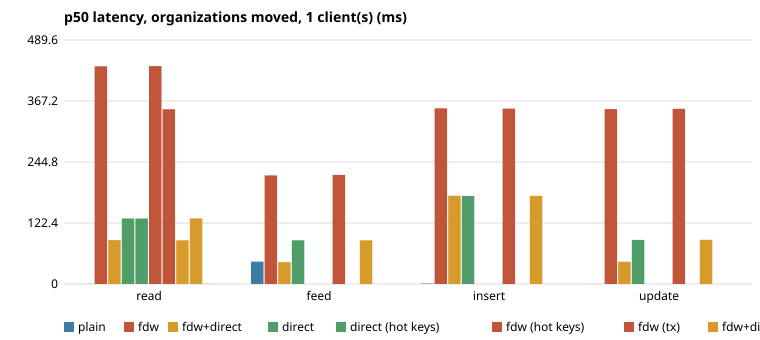
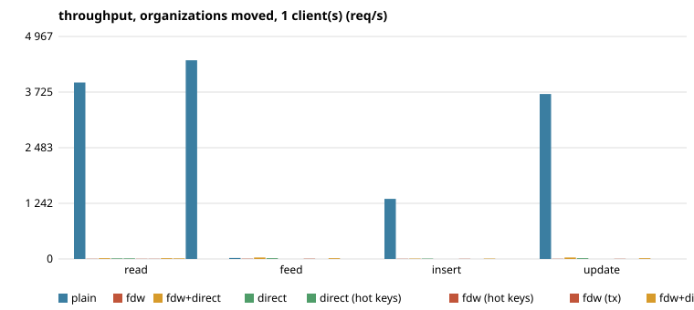
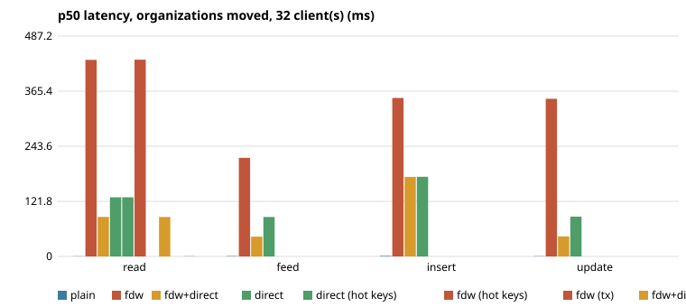
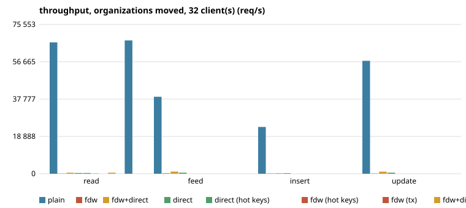

## 2026-10-26-paths

- run: 2026-10-26 (paths), LokaDB `c9e50325dff6ef2b8cd9cd30c9771203728d34b1`, Postgres 18.6 (Debian 18.6-1.pgdg13+2)
- load: warm-up 15s, measured 60s, 2 repeats (median)
- cloud: 8 CPU, 32095 MB, disk  100G 1 disk
- proxy+relay: 4 CPU, 15991 MB, disk  60G 1 disk
- load: 4 CPU, 15991 MB, disk  60G 1 disk
- org1: 2 CPU, 7939 MB, disk  40G 1 disk
- org2: 2 CPU, 3913 MB, disk  50G 1 disk
- org3: 2 CPU, 3913 MB, disk  50G 1 disk
- org4: 2 CPU, 3913 MB, disk  50G 1 disk
- org5: 4 CPU, 7939 MB, disk  80G 1 disk
- RTT ms min/avg/max, start: cloud>proxy 0.150/0.209/0.487; cloud>relay 0.170/0.304/1.365; cloud>load 0.188/0.286/0.729; cloud>org1 0.158/0.206/0.390; cloud>org2 9.365/9.494/10.027; cloud>org3 38.725/38.796/38.944; cloud>org4 43.243/43.364/43.885; cloud>org5 49.146/49.283/50.132
- RTT ms min/avg/max, end: cloud>proxy 0.125/0.170/0.302; cloud>relay 0.125/0.166/0.201; cloud>load 0.197/0.284/0.520; cloud>org1 0.179/0.278/0.581; cloud>org2 9.446/9.868/11.257; cloud>org3 38.701/38.895/39.822; cloud>org4 44.077/44.193/44.440; cloud>org5 49.146/50.012/55.079

#### organizations: cloud, 1 client(s)

| op | config | req/s (min–max of repeats) | p50 ms | p95 ms | p99 ms | errors | first error |
|---|---|---|---|---|---|---|---|
| read | fdw | 1 201 (1 199–1 203) | 0.82 | 0.94 | 1.32 |  |  |
| read | fdw (hot keys) | 1 573 (1 571–1 575) | 0.61 | 0.73 | 0.95 |  |  |
| feed | fdw | 190 (183–197) | 5.28 | 5.75 | 6.29 |  |  |
| insert | fdw | 612 (602–621) | 1.51 | 2.03 | 4.56 |  |  |
| update | fdw | 1 975 (1 974–1 975) | 0.49 | 0.56 | 0.75 |  |  |

#### organizations: cloud, 32 client(s)

| op | config | req/s (min–max of repeats) | p50 ms | p95 ms | p99 ms | errors | first error |
|---|---|---|---|---|---|---|---|
| read | fdw | 15 072 (15 059–15 085) | 1.98 | 3.41 | 5.25 |  |  |
| read | fdw (hot keys) | 14 829 (14 463–15 195) | 1.93 | 4.17 | 6.1 |  |  |
| feed | fdw | 1 037 (1 033–1 041) | 29.25 | 43.7 | 49.6 |  |  |
| insert | fdw | 8 769 (8 732–8 806) | 3.49 | 5.08 | 7.01 |  |  |
| update | fdw | 26 862 (25 510–28 215) | 1.06 | 1.91 | 3.94 |  |  |

#### organizations: moved, 1 client(s)

| op | config | req/s (min–max of repeats) | p50 ms | p95 ms | p99 ms | errors | first error |
|---|---|---|---|---|---|---|---|
| read | plain | 3 940 (3 761–4 118) | 0.25 | 0.3 | 0.41 |  |  |
| read | fdw | 3 (3–3) | 436.9 | 502.96 | 511.34 |  |  |
| read | fdw+direct | 17 | 87.99 | 101.23 | 102.17 |  |  |
| read | direct | 11 (11–11) | 131.43 | 151.41 | 152.39 |  |  |
| read | direct (hot keys) | 11 (11–11) | 131.47 | 151.92 | 166.72 |  |  |
| read | fdw (hot keys) | 3 | 437.12 | 502.54 | 504.61 |  |  |
| read | fdw (tx) | 4 | 350.66 | 396.66 | 421.01 |  |  |
| read | fdw+direct (hot keys) | 17 (17–17) | 87.69 | 99.8 | 101 |  |  |
| read | fdw+direct (tx) | 11 (11–11) | 131.63 | 151.49 | 152.87 |  |  |
| read | plain (hot keys) | 4 435 (4 378–4 491) | 0.21 | 0.27 | 0.35 |  |  |
| feed | plain | 22 (21–23) | 44.99 | 54.65 | 56.47 |  |  |
| feed | fdw | 7 (7–7) | 217.9 | 253.33 | 268.64 |  |  |
| feed | fdw+direct | 33 (33–33) | 44.01 | 50.01 | 50.58 |  |  |
| feed | direct | 17 (17–17) | 87.62 | 100.94 | 102.37 |  |  |
| feed | fdw (tx) | 7 (6–7) | 218.99 | 267.9 | 324.49 |  |  |
| feed | fdw+direct (tx) | 17 (17–17) | 87.62 | 100.72 | 102.05 |  |  |
| insert | plain | 1 341 (1 324–1 359) | 0.71 | 0.85 | 1.65 |  |  |
| insert | fdw | 4 (4–4) | 352.44 | 418.28 | 448.16 |  |  |
| insert | fdw+direct | 8 (8–8) | 177.27 | 199.96 | 202.02 |  |  |
| insert | direct | 8 | 176.77 | 202.87 | 204.25 |  |  |
| insert | fdw (tx) | 4 | 351.95 | 396.91 | 400.05 |  |  |
| insert | fdw+direct (tx) | 8 (8–8) | 176.93 | 203.45 | 205.41 |  |  |
| update | plain | 3 681 | 0.25 | 0.34 | 0.52 |  |  |
| update | fdw | 4 (4–4) | 350.83 | 403.69 | 405.79 |  |  |
| update | fdw+direct | 33 (33–33) | 44.79 | 50.61 | 52.18 |  |  |
| update | direct | 16 (16–16) | 88.52 | 101.69 | 103.37 |  |  |
| update | fdw (tx) | 4 (4–4) | 351.5 | 399.3 | 406.17 |  |  |
| update | fdw+direct (tx) | 16 (16–16) | 88.61 | 103.19 | 106.21 |  |  |

#### organizations: moved, 32 client(s)

| op | config | req/s (min–max of repeats) | p50 ms | p95 ms | p99 ms | errors | first error |
|---|---|---|---|---|---|---|---|
| read | plain | 66 496 (66 335–66 657) | 0.45 | 0.67 | 1.03 |  |  |
| read | fdw | 108 (108–108) | 434.66 | 500.36 | 502.56 |  |  |
| read | fdw+direct | 535 (535–535) | 87.44 | 100.45 | 100.83 |  |  |
| read | direct | 358 (358–358) | 130.76 | 150.44 | 151.3 |  |  |
| read | direct (hot keys) | 357 (357–357) | 130.7 | 150.6 | 153.87 |  |  |
| read | fdw (hot keys) | 108 (108–108) | 434.98 | 493.56 | 502.77 |  |  |
| read | fdw+direct (hot keys) | 536 (536–536) | 87.28 | 100.51 | 101.3 |  |  |
| read | plain (hot keys) | 67 458 (66 532–68 385) | 0.44 | 0.65 | 1.08 |  |  |
| feed | plain | 38 962 (38 761–39 164) | 0.79 | 0.87 | 1.73 |  |  |
| feed | fdw | 213 (213–214) | 218.09 | 251.35 | 255.82 |  |  |
| feed | fdw+direct | 1 071 (1 067–1 074) | 43.66 | 50.27 | 50.89 |  |  |
| feed | direct | 536 (534–537) | 87.25 | 100.52 | 102.39 |  |  |
| insert | plain | 23 673 (23 189–24 158) | 1.23 | 1.98 | 3.03 |  |  |
| insert | fdw | 133 (133–133) | 350.32 | 406.91 | 430.53 |  |  |
| insert | fdw+direct | 265 (265–265) | 175.92 | 201.76 | 202.8 |  |  |
| insert | direct | 264 (264–265) | 176.14 | 202.17 | 203.83 |  |  |
| update | plain | 57 166 (56 337–57 994) | 0.5 | 0.72 | 1.73 |  |  |
| update | fdw | 134 (134–134) | 348.65 | 395.85 | 404.58 | 8 | ERROR: could not serialize access due to concurrent update ( |
| update | fdw+direct | 1 050 (1 050–1 051) | 44.3 | 50.98 | 51.94 |  |  |
| update | direct | 526 (525–528) | 88.07 | 101.42 | 104.77 |  |  |

#### a new connection

| config | class | step | p50 ms | p95 ms | p99 ms |
|---|---|---|---|---|---|
| fdw | cloud | connect | 5.86 | 6.95 | 7.82 |
| fdw | cloud | first_query | 1.38 | 1.62 | 1.86 |
| fdw | moved | connect | 5.93 | 6.68 | 7.84 |
| fdw | moved | first_query | 10.47 | 12.38 | 15.43 |
| fdw+direct | moved | connect | 5.73 | 6.42 | 7.21 |
| fdw+direct | moved | first_query | 7.31 | 8.15 | 8.82 |
| plain | moved | connect | 2.93 | 3.35 | 3.9 |
| plain | moved | first_query | 1.05 | 1.28 | 1.44 |
