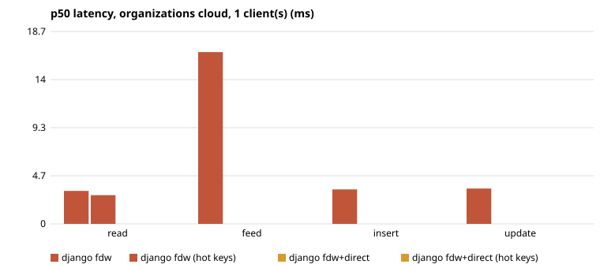
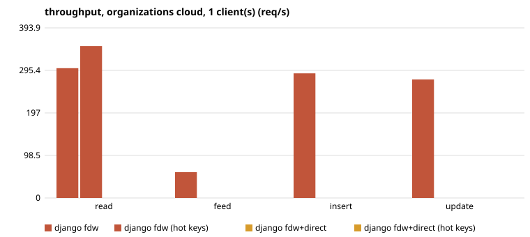
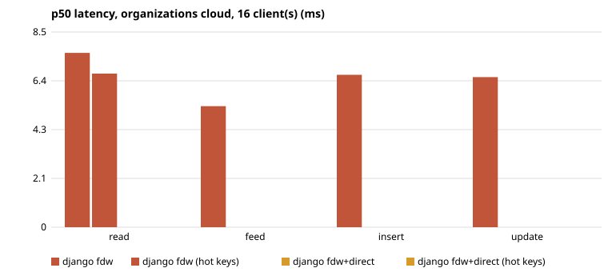
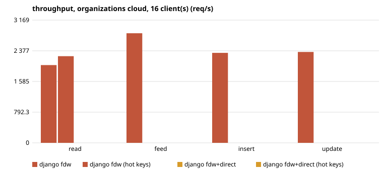
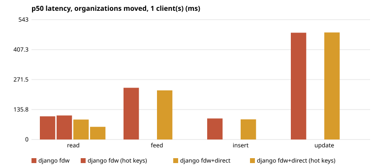
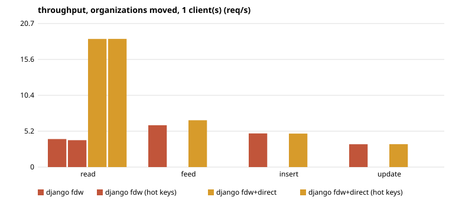
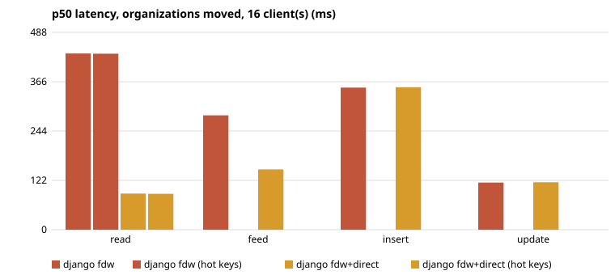
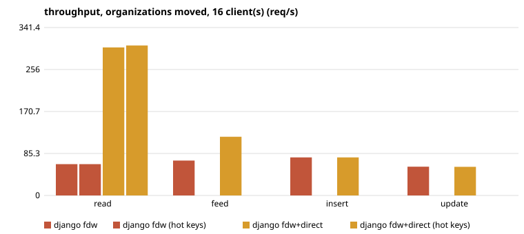

## 2026-10-27-fixed-http

- run: 2026-10-27-fixed (http), LokaDB `4d38caa1cb4c54fc6444a58ca14d59a363305eeb dirty`, Postgres 18.6 (Debian 18.6-1.pgdg13+2)
- load: warm-up 15s, measured 60s, 2 repeats (median)
- cloud: 8 CPU, 32095 MB, disk  100G 1 disk
- proxy+relay: 4 CPU, 15991 MB, disk  60G 1 disk
- load: 4 CPU, 15991 MB, disk  60G 1 disk
- org1: 2 CPU, 7939 MB, disk  40G 1 disk
- org2: 2 CPU, 3913 MB, disk  50G 1 disk
- org3: 2 CPU, 3913 MB, disk  50G 1 disk
- org4: 2 CPU, 3913 MB, disk  50G 1 disk
- RTT ms min/avg/max, start: cloud>proxy 0.130/0.205/0.744; cloud>relay 0.141/0.212/0.722; cloud>load 0.166/0.245/0.537; cloud>org1 0.174/0.227/0.291; cloud>org2 9.384/9.447/9.568; cloud>org3 38.766/39.011/40.473; cloud>org4 44.096/44.243/44.875
- RTT ms min/avg/max, end: cloud>proxy 0.139/0.174/0.422; cloud>relay 0.133/0.154/0.229; cloud>load 0.149/0.196/0.408; cloud>org1 0.163/0.196/0.299; cloud>org2 9.368/9.535/10.311; cloud>org3 38.696/38.778/38.954; cloud>org4 43.359/43.523/44.200

#### organizations: cloud, 1 client(s)

| op | config | req/s (min–max of repeats) | p50 ms | p95 ms | p99 ms | errors | first error |
|---|---|---|---|---|---|---|---|
| read | django fdw | 301 (297–304) | 3.2 | 4.02 | 5.23 |  |  |
| read | django fdw (hot keys) | 352 (349–354) | 2.78 | 3.53 | 4.18 |  |  |
| feed | django fdw | 60 (59–61) | 16.66 | 30.65 | 34.12 |  |  |
| insert | django fdw | 289 (288–289) | 3.34 | 4.15 | 5.33 |  |  |
| update | django fdw | 274 (270–279) | 3.43 | 4.48 | 8.01 |  |  |

#### organizations: cloud, 16 client(s)

| op | config | req/s (min–max of repeats) | p50 ms | p95 ms | p99 ms | errors | first error |
|---|---|---|---|---|---|---|---|
| read | django fdw | 2 008 (1 972–2 043) | 7.61 | 11.97 | 15.32 |  |  |
| read | django fdw (hot keys) | 2 239 (2 229–2 248) | 6.71 | 11.31 | 13.63 |  |  |
| feed | django fdw | 2 830 (2 815–2 844) | 5.29 | 9.71 | 11.93 |  |  |
| insert | django fdw | 2 324 (2 266–2 382) | 6.66 | 9.48 | 12.13 |  |  |
| update | django fdw | 2 347 (2 308–2 387) | 6.56 | 9.51 | 12.31 |  |  |

#### organizations: moved, 1 client(s)

| op | config | req/s (min–max of repeats) | p50 ms | p95 ms | p99 ms | errors | first error |
|---|---|---|---|---|---|---|---|
| read | django fdw | 4 | 105.08 | 454.48 | 458.16 |  |  |
| read | django fdw (hot keys) | 4 (4–4) | 108.92 | 457.9 | 647.09 |  |  |
| read | django fdw+direct | 19 (18–19) | 90.29 | 94.72 | 96.14 |  |  |
| read | django fdw+direct (hot keys) | 19 (18–19) | 57.39 | 94.4 | 95.85 |  |  |
| feed | django fdw | 6 | 234.31 | 352.14 | 405.68 |  |  |
| feed | django fdw+direct | 7 (7–7) | 222.6 | 309.16 | 318.56 |  |  |
| insert | django fdw | 5 | 95.34 | 367.67 | 373.35 |  |  |
| insert | django fdw+direct | 5 (5–5) | 91.24 | 369.1 | 373.05 |  |  |
| update | django fdw | 3 (3–4) | 483.83 | 686.19 | 693.36 |  |  |
| update | django fdw+direct | 3 (3–4) | 484.84 | 683.55 | 695.44 |  |  |

#### organizations: moved, 16 client(s)

| op | config | req/s (min–max of repeats) | p50 ms | p95 ms | p99 ms | errors | first error |
|---|---|---|---|---|---|---|---|
| read | django fdw | 64 (64–64) | 435.7 | 454.95 | 456.47 |  |  |
| read | django fdw (hot keys) | 64 (64–64) | 435.19 | 454.62 | 455.81 |  |  |
| read | django fdw+direct | 301 (299–303) | 89.3 | 94.06 | 96.62 |  |  |
| read | django fdw+direct (hot keys) | 305 (304–306) | 88.85 | 93.2 | 95.05 |  |  |
| feed | django fdw | 71 (70–72) | 282.81 | 377.45 | 397.59 |  |  |
| feed | django fdw+direct | 119 (119–120) | 149.23 | 238.65 | 244.04 |  |  |
| insert | django fdw | 77 (77–78) | 351.33 | 367.39 | 373.42 |  |  |
| insert | django fdw+direct | 77 (77–78) | 352.32 | 366.78 | 377.91 |  |  |
| update | django fdw | 58 (58–58) | 116.66 | 501.82 | 503.53 | 2 | HTTP 500: <!doctype html> <html lang="en"> <head> <title>Ser |
| update | django fdw+direct | 58 (58–58) | 117.38 | 500.4 | 502.16 | 2 | HTTP 500: <!doctype html> <html lang="en"> <head> <title>Ser |

