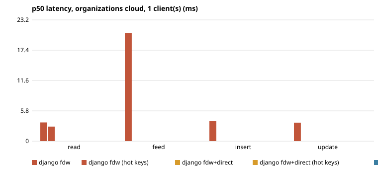
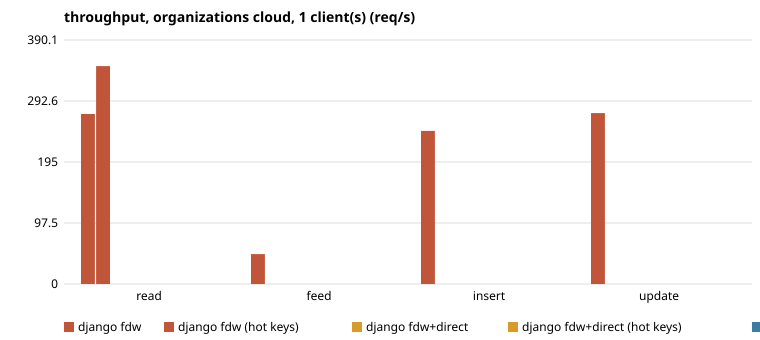
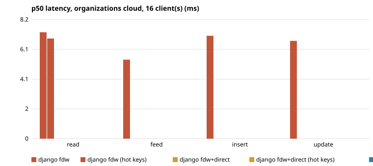
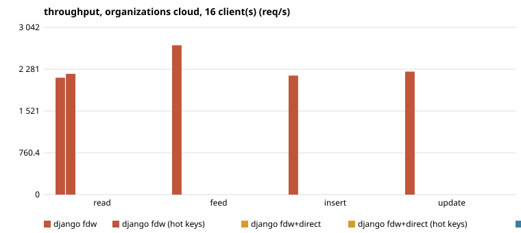
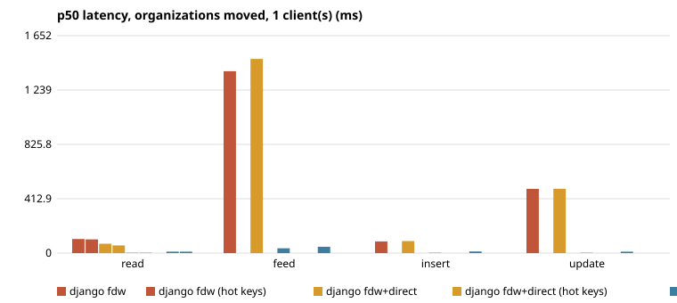
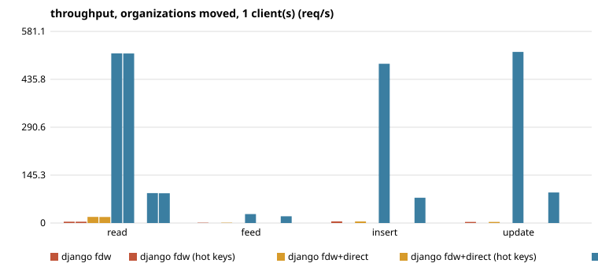
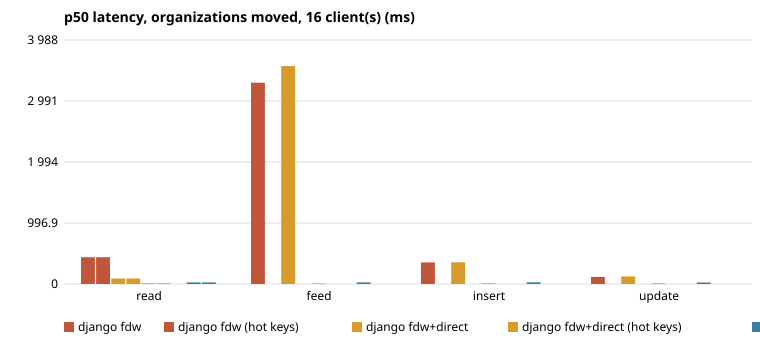
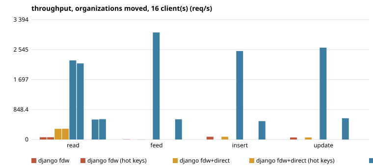

## 2026-10-27-http

- run: 2026-10-27 (http), LokaDB `9f405c2110073afc3851972b14336cc57f819141`, Postgres 18.6 (Debian 18.6-1.pgdg13+2)
- load: warm-up 15s, measured 60s, 2 repeats (median)
- cloud: 8 CPU, 32095 MB, disk  100G 1 disk
- proxy+relay: 4 CPU, 15991 MB, disk  60G 1 disk
- load: 4 CPU, 15991 MB, disk  60G 1 disk
- org1: 2 CPU, 7939 MB, disk  40G 1 disk
- org2: 2 CPU, 3913 MB, disk  50G 1 disk
- org3: 2 CPU, 3913 MB, disk  50G 1 disk
- org4: 2 CPU, 3913 MB, disk  50G 1 disk
- RTT ms min/avg/max, start: cloud>proxy 0.131/0.162/0.349; cloud>relay 0.133/0.147/0.169; cloud>load 0.136/0.168/0.289; cloud>org1 0.128/0.180/0.363; cloud>org2 9.355/9.439/9.794; cloud>org3 38.695/39.046/41.393; cloud>org4 43.341/43.396/43.686
- RTT ms min/avg/max, end: cloud>proxy 0.147/0.224/0.333; cloud>relay 0.192/0.414/1.627; cloud>load 0.206/0.257/0.385; cloud>org1 0.202/0.222/0.260; cloud>org2 9.339/9.389/9.437; cloud>org3 38.735/38.871/39.581; cloud>org4 43.446/43.556/44.106

#### organizations: cloud, 1 client(s)

| op | config | req/s (min–max of repeats) | p50 ms | p95 ms | p99 ms | errors | first error |
|---|---|---|---|---|---|---|---|
| read | django fdw | 272 (266–278) | 3.58 | 4.44 | 5.32 |  |  |
| read | django fdw (hot keys) | 348 (331–365) | 2.79 | 3.65 | 5.11 |  |  |
| feed | django fdw | 48 (45–50) | 20.74 | 41.07 | 45.43 |  |  |
| insert | django fdw | 245 (239–250) | 3.89 | 5.15 | 8.89 |  |  |
| update | django fdw | 273 (273–274) | 3.54 | 4.36 | 5.4 |  |  |

#### organizations: cloud, 16 client(s)

| op | config | req/s (min–max of repeats) | p50 ms | p95 ms | p99 ms | errors | first error |
|---|---|---|---|---|---|---|---|
| read | django fdw | 2 127 (2 031–2 222) | 7.29 | 10.8 | 13.18 |  |  |
| read | django fdw (hot keys) | 2 198 (2 150–2 247) | 6.87 | 11.45 | 13.88 |  |  |
| read | laravel fdw | - | - | - | - |  |  |
| feed | django fdw | 2 716 (2 647–2 785) | 5.42 | 10.36 | 12.82 |  |  |
| feed | laravel fdw | - | - | - | - |  |  |
| insert | django fdw | 2 166 (2 149–2 183) | 7.05 | 10.52 | 14.56 |  |  |
| insert | laravel fdw | - | - | - | - |  |  |
| update | django fdw | 2 238 (2 150–2 326) | 6.71 | 11 | 15.59 |  |  |
| update | laravel fdw | - | - | - | - |  |  |

#### organizations: moved, 1 client(s)

| op | config | req/s (min–max of repeats) | p50 ms | p95 ms | p99 ms | errors | first error |
|---|---|---|---|---|---|---|---|
| read | django fdw | 4 (4–4) | 107.01 | 446.89 | 465.1 |  |  |
| read | django fdw (hot keys) | 4 (4–4) | 104.31 | 446.93 | 628.44 |  |  |
| read | django fdw+direct | 18 (18–19) | 71.06 | 94.12 | 94.9 |  |  |
| read | django fdw+direct (hot keys) | 18 (18–19) | 57.9 | 93.54 | 95.62 |  |  |
| read | django plain | 514 (501–528) | 1.81 | 2.49 | 3.43 |  |  |
| read | django plain (hot keys) | 514 (513–516) | 1.85 | 2.45 | 2.76 |  |  |
| read | laravel plain | 91 (89–92) | 10.78 | 13.1 | 14.9 |  |  |
| read | laravel plain (hot keys) | 90 (89–92) | 10.78 | 13.2 | 15.4 |  |  |
| feed | django fdw | 1 | 1 381 | 1 576 | 1 586 |  |  |
| feed | django fdw+direct | 1 | 1 475 | 1 766 | 1 945 |  |  |
| feed | django plain | 27 (27–27) | 36.66 | 41.8 | 46.81 |  |  |
| feed | laravel plain | 20 (19–21) | 48.38 | 59.66 | 65.01 |  |  |
| insert | django fdw | 5 (5–5) | 88.7 | 360.58 | 363.69 |  |  |
| insert | django fdw+direct | 5 (5–5) | 91.17 | 367.7 | 375.39 |  |  |
| insert | django plain | 483 (473–493) | 1.96 | 2.56 | 3.12 |  |  |
| insert | laravel plain | 77 (76–77) | 12.51 | 16.42 | 22.27 |  |  |
| update | django fdw | 3 (3–4) | 488.01 | 673.26 | 679.6 |  |  |
| update | django fdw+direct | 3 (3–4) | 488.42 | 682.76 | 690.05 |  |  |
| update | django plain | 519 (499–539) | 1.77 | 2.47 | 4.74 |  |  |
| update | laravel plain | 93 (87–98) | 10.51 | 13.35 | 15.38 |  |  |

#### organizations: moved, 16 client(s)

| op | config | req/s (min–max of repeats) | p50 ms | p95 ms | p99 ms | errors | first error |
|---|---|---|---|---|---|---|---|
| read | django fdw | 64 (64–64) | 438.41 | 449.37 | 454.97 |  |  |
| read | django fdw (hot keys) | 64 (64–64) | 438.27 | 449.18 | 450.82 |  |  |
| read | django fdw+direct | 303 (303–304) | 89.74 | 92.81 | 93.94 |  |  |
| read | django fdw+direct (hot keys) | 304 (304–304) | 89.68 | 92.67 | 93.57 |  |  |
| read | django plain | 2 239 (2 196–2 282) | 6.19 | 12.8 | 15.75 |  |  |
| read | django plain (hot keys) | 2 155 (2 127–2 182) | 6.44 | 13.67 | 16.81 |  |  |
| read | laravel fdw | - | - | - | - |  |  |
| read | laravel plain | 565 (553–578) | 25.97 | 48.52 | 62.77 |  |  |
| read | laravel plain (hot keys) | 576 (573–579) | 25.56 | 47.73 | 61.67 |  |  |
| feed | django fdw | 5 (5–5) | 3 290 | 4 288 | 4 702 |  |  |
| feed | django fdw+direct | 5 (5–5) | 3 560 | 4 780 | 5 556 |  |  |
| feed | django plain | 3 030 (3 012–3 048) | 4.71 | 9.52 | 12.05 |  |  |
| feed | laravel fdw | - | - | - | - |  |  |
| feed | laravel plain | 572 (571–573) | 25.53 | 49.14 | 62.99 |  |  |
| insert | django fdw | 78 (77–78) | 353.17 | 362.8 | 369.65 |  |  |
| insert | django fdw+direct | 78 (77–78) | 354.11 | 362.58 | 364.69 |  |  |
| insert | django plain | 2 504 (2 496–2 512) | 6.12 | 9.63 | 12.69 |  |  |
| insert | laravel fdw | - | - | - | - |  |  |
| insert | laravel plain | 520 (512–527) | 28.35 | 52.26 | 67.6 | 3 | HTTP 500: <!DOCTYPE html> <html lang="en"> <head> <meta char |
| update | django fdw | 59 (59–59) | 115.79 | 495.81 | 497.23 | 2 | HTTP 500: <!doctype html> <html lang="en"> <head> <title>Ser |
| update | django fdw+direct | 58 (58–58) | 123.64 | 496.86 | 503.06 | 2 | HTTP 500: <!doctype html> <html lang="en"> <head> <title>Ser |
| update | django plain | 2 601 (2 561–2 641) | 5.92 | 9.45 | 11.45 |  |  |
| update | laravel fdw | - | - | - | - |  |  |
| update | laravel plain | 602 (591–614) | 24.36 | 45.97 | 59.49 |  |  |

